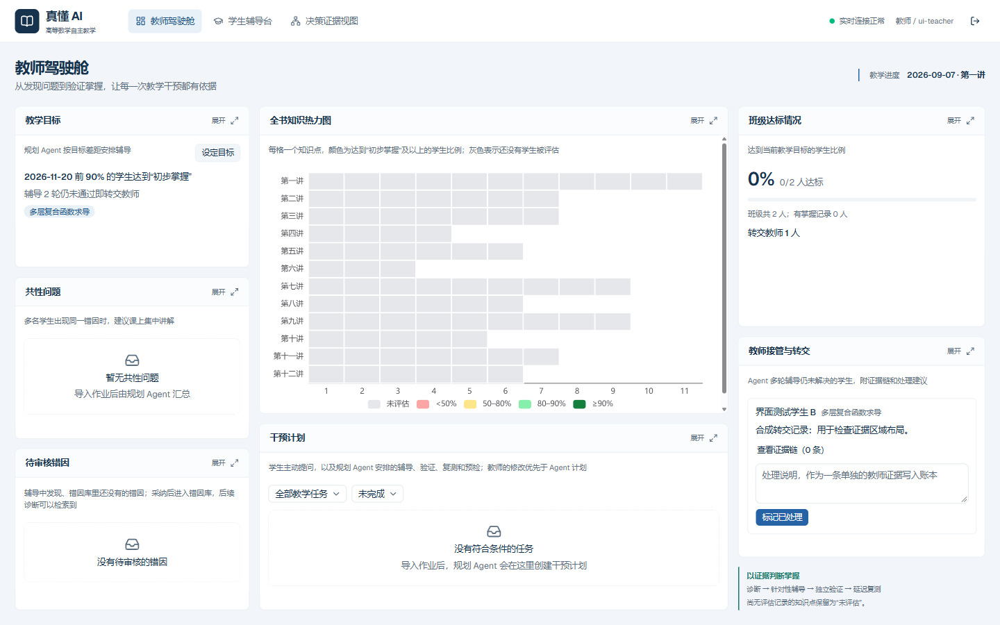
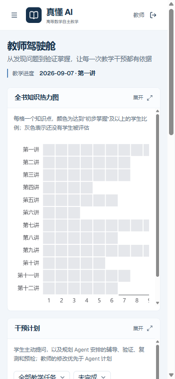

# 工作台改版与代码检查

2026-11-12；基线 `main@c035a20`。参考用户指定的明鉴 `06_源代码/源码/api-service/static/mingjian/` 整理版，采用紧凑蓝灰工作台、桌面一屏布局和点击模块展开的交互。参考项目未修改。

## 本轮完成

- **教师驾驶舱**：横向导航；左侧目标、共性问题和待审核错因，中间热力图与干预计划，右侧达标情况与教师转交。宽度至少 1200px、可用高度至少 720px 时使用一屏总览，其余尺寸允许页面滚动。
- **模块展开**：点击标题切换为占满工作区的详情视图，返回按钮或 Esc 收起。原组件保持挂载，草稿、筛选和实时订阅保留；嵌套 Sheet、选择器和公式输入优先处理 Esc。采用原位展开，教师编辑表单仍可在模块上正常打开。
- **学生与证据页面**：学生任务和作答区域主次分明，增加学习路径说明；证据页面分区显示诊断、时间线和六维验证，可展开细读，桌面可并排查看辅导会话。
- **统一视觉**：藏蓝品牌、教学蓝操作色、浅灰蓝底色；登录页面说明发现问题、诊断辅导、独立验证的关系。窄屏改为抽屉导航和纵向布局，保留键盘焦点、跳到主要内容入口和减少动画设置。
- **统计展示修正**：没有教学目标时不显示“0% 达标”；改为提示尚未设置目标。目标加载失败时也不展示达标百分比。概览补充班级总人数和有掌握记录的人数，热力图继续区分未评估。

## 代码完整性结论

T15 主动提问、T16 教师协同、T26 登录与权限以及决策证据页面已在基线主干中接入。内容检查为 12 讲、80 个知识点、93 个错因、27 张策略卡、131 道题，0 个内容错误；本轮后端 340 项测试通过。

这些结果不能代替真实教学链路的验收：

1. 按最新《开发计划》，真实模型下的缩减预跑、双库验收快照、公网部署和视频仍需继续完成。UI 检查使用隔离库中的两名合成学生，没有调用真实模型，不作为教学成效或 T21R 完成证明。
2. `backend/app/api/student.py` 的 `GET /api/tasks/{task_id}` 仍为 T08 遗留桩，返回 501。当前前端通过任务列表、消息和作答目标等接口工作，未调用这个单任务接口。本轮未修改该接口或公开契约。
3. 最新计划列出的多会话运行风险仍需按 T21R/T27R 做真实教师、学生双会话冒烟；本轮的权限和页面检查不等于模型并发验收。

## 验证记录

| 检查 | 结果 |
| --- | --- |
| 后端 `pytest -q` | 340 passed；122 条既有 LangGraph/Pydantic 警告，无失败 |
| Ruff 检查与格式 | 通过 |
| OpenAPI 一致性 | 通过，未变更契约 |
| 教学内容检查 | 通过，0 错误 |
| 前端 lint、格式、生产构建 | 通过；lint 保留 `router.tsx` 与 `auth.tsx` 的 4 条既有 Fast Refresh 提示 |
| 桌面浏览器 | CSS 视口 1600×1000：页面宽高未超出视口，七个模块可见；实际热力图 80 格均保持未评估 |
| 展开与表单 | 教学目标展开后可打开并保存目标；Esc 先关闭表单，再返回总览并聚焦原按钮；教师转交处理说明在展开切换后保留 |
| 未设置目标 | 隔离库清除目标后，概览显示尚未设置目标，不显示误导性的 0%；随后通过页面保存了 85% 目标并重新读取 |
| 学生与证据页面 | 提问表单可打开；证据模块可展开，辅导会话入口可显示；没有诊断或验证记录时保留空状态 |
| 权限 | 学生仅能查看本人，无教师导航；教师页面重定向回辅导台，班级概览接口返回 403 |
| 窄屏浏览器 | CSS 视口 390×844：教师、学生页面均无整体横向溢出；热力图在模块内部横向滚动 |

浏览器截图中的学生、任务和转交记录均为合成 UI 测试数据；账号、数据库、浏览器脚本和服务日志留在忽略目录 `backend/data/workspace-qa/`，不随代码提交。下图仅用于评审界面。

