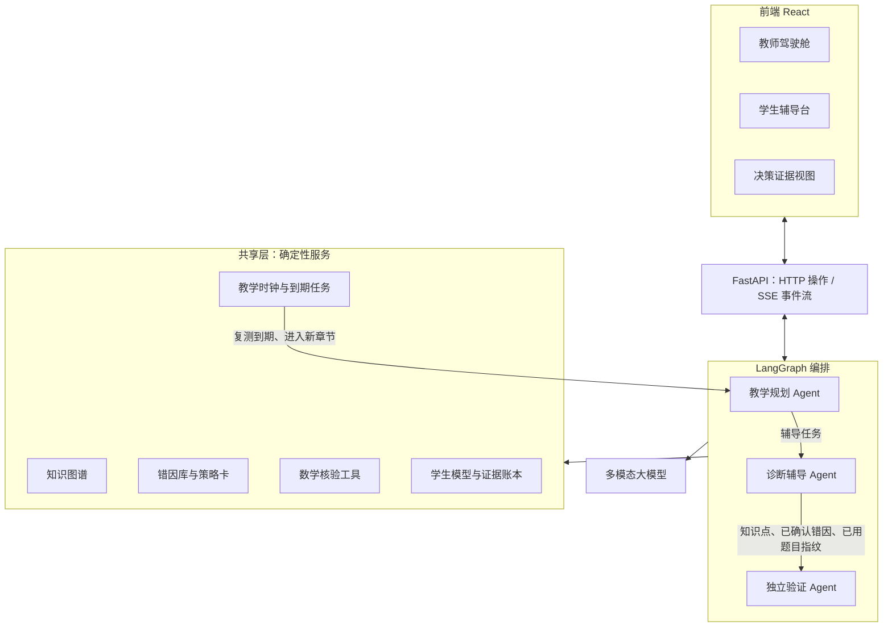
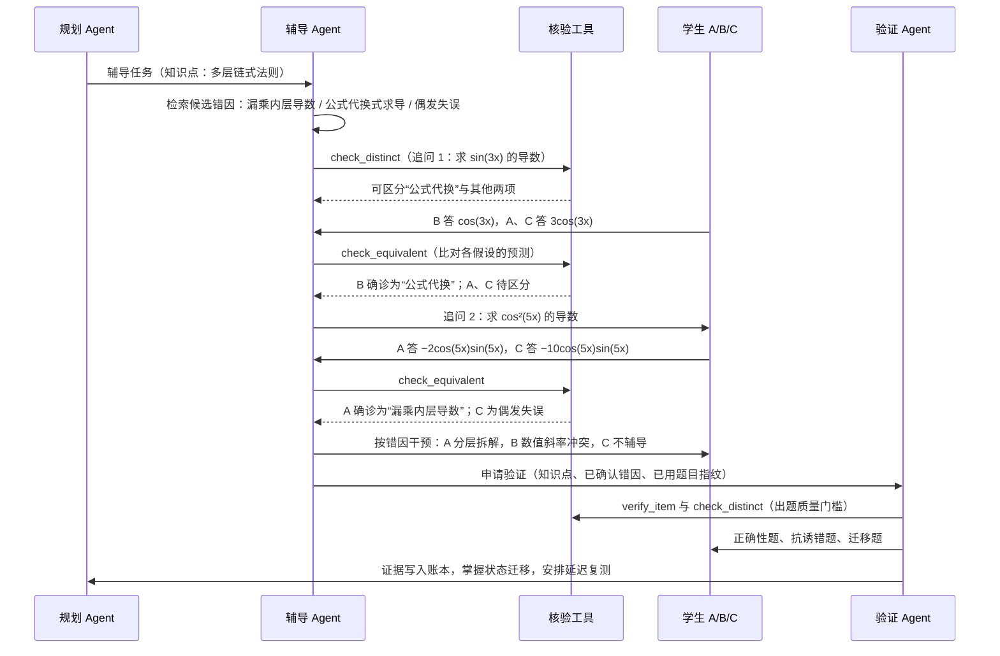

# 真懂 AI｜高校高等数学自主教学 Agent 技术方案

> 技术决策版 · 2026-11-05 · 依据《作品简介》《高等数学目录》
>
> **核心选择：一个多模态大模型 + 三个逻辑 Agent + 事件驱动的教学工作流 + 知识图谱与错因库 + 数学核验工具 + 可追溯证据账本。** 目标不是替学生答题，而是自主决定“找谁、补什么、怎么教、如何证明已学会、何时再查、何时交给教师”。大模型负责理解学生和组织教学，数学结果的对错优先由核验工具判定。

## 1. 整体架构：事件驱动的自主教学闭环

采用前后端分离架构，Python 后端保持模块化单体。React 前端提供教师驾驶舱、学生辅导台和 Agent 决策证据视图；FastAPI 通过 HTTP 处理操作，通过 SSE 推送辅导文本与教学事件；LangGraph 组织三个 Agent 的状态流转；三个 Agent 通过 OpenAI 兼容接口调用同一个多模态大模型。知识图谱、错因库、数学核验工具、教学时钟和状态存储是共享的确定性服务。



**主链路：** 作业/小测或章节事件 → 批量识别风险及共性问题 → 规划个体/班级干预 → 对话式诊断与辅导 → 独立出题验证 → 更新掌握状态和证据 → 延迟复测/新章节预检 → 必要时转交教师。教师能审批或改写计划、直接接管，但常规推进不依赖教师逐步点击。

- **覆盖范围：** 以目录中的 **12 讲、75 节**为骨架，按概念细化约 150 个知识点，标注先修关系、后续应用、章节和数学一/二/三适用范围。图谱节点可由目录和模型辅助拆分生成，再由教师校核关键依赖。比赛时精修两条路径（见第 8 节），不为 150 个节点分别开发教学流程。
- **主动性来源：** 作业导入、作答结果、复测到期、课程进入新章节等事件自动唤起规划。Agent 在教师设定的目标、截止日期和干预次数限制下作决策；事件触发、任务执行、规则约束及提醒由程序完成。
- **分离两类状态：** LangGraph checkpoint 保存正在进行的辅导/验证会话；业务数据库保存跨会话的学生模型、计划、复测任务与**只追加的证据账本**。掌握结论必须由证据驱动。

## 2. Agent 设计：三种不可混淆的决策权

三个 Agent 是**调用同一多模态大模型的三套逻辑角色和隔离上下文**，由同一后端进程按任务调用，不需要独立模型或常驻进程。

| Agent | 可自主决定 | 输入与边界 | 主要产物 |
|---|---|---|---|
| **教学规划 Agent**（班级/长期） | 谁需要干预；先补哪个先修点；个辅还是建议集体讲解；何时安排复测、跨章预检或转教师 | 教师目标、作业信号、学生证据、依赖图；必须服从期限、轮次上限及教师接管指令 | 可解释的学生计划、共性问题建议、待办任务 |
| **诊断辅导 Agent**（个体/短期） | 从错因库选择候选错因；选择区分性追问、讲解策略、练习难度及回溯路径；发现无效时请求重规划 | 当前题目/图片、学生回答、错因库、策略卡、允许的先修节点；**不能修改假设状态或掌握状态** | 教学动作、辅导记录、待审核的未建模错因 |
| **独立验证 Agent**（评价） | 独立生成新测题、评价解释质量、按考查维度给出判定 | **接收：** 目标知识点、考查维度、已确认错因的 ID 与描述、已用题目指纹。**不接收：** 辅导对话、讲解内容、学生在辅导中的作答 | 独立测题、逐维判定、证据记录 |

**教考分离的边界是隔离辅导过程，而不是隔离全部信息。** 验证 Agent 需要知道错因，才能出抗诱错题；需要知道已用题目，才能保证出的是新题。它看不到辅导过程，因此不会押题，也不会放水。

**控制原则：**

- **大模型负责：** 理解题目、学生作答和图片；提出错因假设；生成追问题和预测答案；选择教学策略；评阅文字解释和证明类作答。
- **核验工具负责：** 数学表达式是否等价、题目标准答案是否正确、追问题是否有区分度（第 3 节）。
- **程序负责：** 依赖图遍历、截止日期、轮次阈值、题目去重、输出结构校验、假设状态与掌握状态的迁移。
- **教师指令高于 Agent 计划。**

## 3. 数学核验工具

核验工具以 tool calling 的形式提供给三个 Agent，基于 SymPy 实现，只是一个 Python 库，不单独部署服务。

| 函数 | 作用 | 判定方式 |
|---|---|---|
| `check_equivalent(a, b, mode)` | 判断学生答案与标准答案或某个预测答案是否等价 | `expr`：符号化简后差为 0；化简失败时在定义域内随机取 8 个以上的点做数值比较。`antiderivative`：对两者求导后比较，忽略常数 C。`value`：数值比较 |
| `verify_item(spec)` | 出题后独立验算标准答案 | 模型出题时同时给出结构化描述（运算类型、表达式、变量、积分限等），工具按描述重新计算，并与模型给出的答案比较 |
| `check_distinct(answers)` | 确认一道追问题有区分度 | 把候选假设按预测答案分组，与正确答案等价的归入正确答案组（“偶发失误”总在这一组）；至少分成两组即可，学生不论怎么答都能排除至少一个候选。允许部分候选预测相同，由下一道追问题继续区分 |

**输入解析：** 学生用 MathLive 输入公式，系统得到 LaTeX 后解析为 SymPy 表达式。图片作答由模型识别后直接输出 LaTeX，并标注有没有拿不准的地方。转写结果能解析为 SymPy 表达式、模型也没有标注疑问时，直接进入诊断；模型标注了疑问或解析失败时，向学生展示渲染后的公式，请学生确认或修改，避免把识别错误当成学生的错误。解析有歧义时，请学生补充或确认。

**回退规则：** 解析失败，或题型不适合工具判定（证明、文字解释、开放应用题）时，改由模型评阅。第十二讲级数反例也由模型评阅，工具只计算部分和的数值供参考。每条证据都标注判定方式是“工具核验”还是“模型评阅”。**能用工具判定的题目，以工具结果为准。**

**出题质量门槛（程序强制执行）：**

1. `verify_item` 通过；
2. 追问题须通过 `check_distinct`；抗诱错题还要求目标错因的预测不在正确答案组；
3. 题目指纹不在该学生的已用题目中。指纹由题目结构化描述规范化后的哈希值生成。

任一项不满足就重新生成，最多重试 3 次；仍不满足时，从该知识点的种子题中选题。

## 4. 核心数据结构

| 实体 | 关键字段 | 说明 |
|---|---|---|
| 知识点 `KnowledgePoint` | id、讲/节、名称、先修知识点、数学一/二/三标签 | 构成依赖图，用 NetworkX 加载 |
| 错因 `Misconception` | id、所属知识点、错因族、描述、触发特征、典型错例、判别追问题、策略卡、可能复发的知识点、来源（教师编写/待审核） | 错因 ID 全书统一，跨章节跟进依靠它匹配 |
| 策略卡 `StrategyCard` | id、适用错因或错因族、教学原则、约束条件、解释题评分要点 | 具体讲解内容由模型按策略卡现场生成 |
| 题目 `Item` | id、知识点、考查维度、题干、结构化描述、标准答案、各错因的预测答案、指纹、来源（种子题/生成） | 生成题必须通过第 3 节的质量门槛 |
| 假设 `Hypothesis` | 学生、错误事件、错因 ID、状态（待检验/支持/排除）、关联证据 | 状态只由程序根据比对结果更新 |
| 证据 `Evidence` | 学生、知识点、考查维度、题目、学生原答、标准答案、预测答案、是否命中、判定方式（工具核验/模型评阅）、判定理由、教学日期 | 只追加，不修改；教师处理记为单独证据 |
| 掌握状态 `Mastery` | 学生、知识点、状态、状态依据的证据 | 状态迁移规则见第 5 节 |
| 任务 `Task` | 学生、类型（辅导/验证/复测/预检/转教师/课上讲解建议）、目标知识点、到期日期、轮次、状态 | 由规划 Agent 创建，由教学时钟检查是否到期；课上讲解建议面向全班，学生为空，涉及的学生由关联证据确定 |
| 事件 `Event` | 类型（作业导入/作答/学生提问/复测到期/进入新章节/教师指令）、内容、教学日期 | 唤起规划 Agent |
| 学生 `Student` | id、姓名 | 学生名单，演示时为合成学生 |
| 教学目标 `TeachingGoal` | 目标知识点、目标掌握状态、目标比例、截止日期、辅导轮次上限 | 由教师设定，如“周五前 90% 初步掌握、两轮不通过转人工”；规划 Agent 据此排序和判断是否转交教师 |

## 5. 核心机制：让每一步教学决策有可核验依据

### ① 主动发现与教学规划

导入作业（结构化成绩/题目及照片）后，多模态模型提取题意、学生步骤和涉及的知识点，并在错因库中匹配初步错因，以结构化结果返回。系统先按知识点和错因汇总班级信号，再由规划 Agent 结合**目标达成差距、先修阻塞、截止日期、复发风险**决定优先级。多名学生指向同一错因时，建议教师集中讲解；个体缺口创建辅导任务。规划会在新证据出现后自动修订，不是一次性推荐清单。

### ② 可证伪错因诊断

1. **检索候选错因。** 辅导 Agent 从该知识点的错因库中选出 2 到 3 个候选错因，“偶发失误”也作为一个候选参与比较。错因库中没有合适的候选时，模型自由生成假设，标记为“未建模错因”，并推送到教师端的待审核列表。
2. **选择追问题。** 优先使用错因库中现成的判别追问题；没有现成题目时，由模型生成追问题及各假设的预测答案，并须通过 `check_distinct`。
3. **更新假设状态。** 学生作答后，程序用 `check_equivalent` 把学生答案逐一与各假设的预测答案比较：命中的假设记为“支持”，未命中的记为“排除”；“偶发失误”的预测答案就是正确答案。全部假设都被排除时，回到第 1 步重新提出假设。
4. **终止条件。** 只剩一个假设处于“支持”状态时确诊。追问达到 3 轮仍无法确诊时，请求规划 Agent 重新规划或转交教师。

**错因是假设；学生在区分性情境中的行为才是证据。**

以作品简介中的案例为例，学生 A、B、C 求 `sin²(3x)` 的导数，都写出了 `2sin(3x)cos(3x)`。以下时序图把三人的辅导会话合并展示：



### ③ 差异化干预与动态重规划

“漏乘内层导数”采用函数嵌套拆解与分层练习；“公式代换式求导”用数值斜率冲突、变化率解释再重做；偶发失误只做一道验证题，不安排长篇补课。每轮采用**追问—判定—反馈—再决定**的小步循环。连续无进展时，沿先修图回退到前置知识点；达到教师设定的轮次上限时，生成教师介入建议。模型决定下一步教学动作，程序校验动作类型、任务上限与状态约束。

### ④ 教考分离与掌握状态机

验证 Agent 按考查维度出题：

| 维度 | 题目要求 |
|---|---|
| 正确性 | 同一知识点的新题 |
| 抗诱错 | 针对已确认错因设计，该错因的预测答案必须不同于正确答案 |
| 近迁移 | 换一种结构或情境 |
| 解释 | 要求说明关键步骤的理由，由模型按策略卡中的评分要点评阅 |
| 保持 | 延迟复测时出新题 |
| 跨章节应用 | 在后续章节的题目中用到该知识点 |

掌握状态由程序根据证据迁移：

| 状态 | 进入条件 |
|---|---|
| 待干预 | 作业或预检中发现错误 |
| 辅导中 | 辅导任务开始 |
| 初步掌握 | 正确性、抗诱错各 1 题通过，近迁移或解释至少 1 项通过 |
| 巩固 | 延迟复测通过 |
| 融会贯通 | 跨章节应用题通过 |
| 错因复现 | 任意一题的答案命中原错因的预测答案，退回“辅导中” |
| 转交教师 | 达到教师设定的轮次上限，或出现无法判定的未建模错因 |

辅导 Agent 和学生自述都不能改变掌握状态。

### ⑤ 跨章节跟进与教师协同

**教学时钟。** 系统维护一个“当前教学日期”。复测和预检任务连同到期日期存入数据库。每次教学日期推进或系统启动时，程序扫描到期任务并生成事件，唤起规划 Agent。正式使用时，教学日期跟随真实日期；演示时，由驾驶舱推进日期。不另外引入定时任务框架。

**章前预检的触发规则。** 课程进入新章节时，对新章节的每个目标知识点，检查它在依赖图上的先修知识点。学生满足以下任一条件时，为其创建预检任务：

- 先修知识点上有已确认的错因；
- 先修知识点的掌握状态未达到“巩固”；
- 学生已确认的某个错因，把该知识点列为“可能复发的知识点”。

例如“第一讲函数复合 → 第二讲链式法则 → 第九讲多元复合求导”：进入第九讲之前，第一周有过链式法则错因的学生会收到预检；旧错复发时，规划 Agent 重排任务。

**教师协同。** 证据账本逐事件记录题目、学生原答、判定方式与理由、教学策略及独立验证结果，构成教师可追溯的升级理由。教师可以更改目标、覆盖计划、接管辅导，或在待审核列表中采纳未建模错因。人工处理记为单独证据，不覆盖历史。

### ⑥ 学生主动提问

学生可以随时拍照或输入一道还没做出来的题来提问。系统不直接给出完整解答，处理流程如下：

1. **先请学生尝试。** 辅导 Agent 请学生写出自己的尝试，或者说明卡在哪一步。模型在后台解题，结果经 `verify_item` 复核，只作为判断对错的依据，不展示给学生。
2. **进入同样的诊断流程。** 学生给出尝试后，按 ② 定位第一处错误并检验错因假设；学生只说明了卡住的位置时，从这一步开始诊断。
3. **分层提示。** 按策略卡由弱到强给出提示：先提示思路方向，再提示关键步骤，最后提示具体计算。每给一层提示，都让学生自己接着往下做。
4. **完整解答兜底。** 三层提示用完，学生仍然做不出来时，再给出完整解答。完成后，规划 Agent 为该学生安排一道同类题作为后续验证。

学生主动提问也会写入证据账本。频繁求助的知识点会作为“主动发现”的信号，提供给规划 Agent。

## 6. 教学内容规格（由数学教师编写）

| 内容 | 精修部分 | 其余知识点 |
|---|---|---|
| 知识点 | 名称、先修关系、数学一/二/三标签 | 同左 |
| 错因 | 每个知识点 2 到 4 个：ID、描述、错因族、可能复发的知识点，以及 1 个典型错例 | 每节至少 1 个高频错因 |
| 判别追问题 | 模型按错因起草，通过 `check_distinct` 后交教师审核 | 不预先准备，辅导时当场生成 |
| 策略卡 | 按错因族编写：教学原则、禁用做法、解释题评分要点，不写逐步教学流程 | 按错因族复用 |
| 种子题 | 每个知识点 1 到 2 道，含结构化描述；只在生成题连续 3 次未通过质量门槛时使用 | 每个知识点至少 1 道 |

追问题、讲解和练习题都可以由模型当场生成，再由程序和核验工具把关。教师只写模型做不准的部分：错因的界定、跨章节的复发关系和教学原则。

内容以 YAML 存储，每讲一个文件，格式和填写模板见仓库的 `content/` 目录。入库时由程序检查：引用的知识点和错因 ID 存在；判别追问题的预测答案通过 `check_distinct`；种子题通过 `verify_item`。错因示例：

```yaml
id: calc.ch2.chain.miss_inner
knowledge_point: calc.ch2.chain_rule_multi
family: 误读复合结构
description: 多层复合时只用一次链式法则，漏乘最内层导数
triggers: [三层及以上复合, 外层为幂函数]
examples:
  - question: "求 sin²(3x) 的导数"
    wrong: "2sin(3x)cos(3x)"
    correct: "6sin(3x)cos(3x)"
probes: [calc.ch2.chain_multi.probe_cos2_5x]  # 判别追问题的 ID，题目由模型起草、教师审核
strategies: [layered_decomposition]
recurs_in: [calc.ch9.multivar_chain, calc.ch2.implicit_diff]
```

## 7. 技术选型

| 领域 | 选型 | 用途 |
|---|---|---|
| 前端 | [React](https://github.com/facebook/react) + [TypeScript](https://github.com/microsoft/TypeScript) + [Vite](https://github.com/vitejs/vite) | 教师驾驶舱、学生辅导台、决策证据视图 |
| UI | [Tailwind CSS](https://github.com/tailwindlabs/tailwindcss) + [shadcn/ui](https://github.com/shadcn-ui/ui) | 组件与样式 |
| 可视化 | [Apache ECharts](https://github.com/apache/echarts) | 班级掌握热力图、六维验证结果、先修路径 |
| 公式显示与输入 | [KaTeX](https://github.com/KaTeX/KaTeX) + [MathLive](https://github.com/arnog/mathlive) | 渲染题目与反馈；学生输入公式 |
| 后端 | [FastAPI](https://github.com/fastapi/fastapi) | HTTP 操作、作业上传、SSE 事件流 |
| Agent 编排 | [LangGraph](https://github.com/langchain-ai/langgraph) + SQLite Checkpointer | 状态流转、暂停与恢复、教师接管 |
| 模型接入 | [OpenAI Python SDK](https://github.com/openai/openai-python) | 统一的 `base_url / api_key / model` 接入。使用 deepseek-flash（`https://api.deepseek.com`），支持图片与公式理解、JSON Schema 结构化输出和工具调用 |
| 数学核验 | [SymPy](https://github.com/sympy/sympy)（含 LaTeX 解析）+ mpmath | 第 3 节的三个核验函数 |
| 知识组织 | [NetworkX](https://github.com/networkx/networkx) + 版本化 YAML | 依赖图查询、回溯路径、章前预检 |
| 业务状态 | [SQLModel](https://github.com/fastapi/sqlmodel) + SQLite | 第 4 节的业务实体，与会话 checkpoint 分开存储 |

**不部署：** 独立 OCR、向量数据库、Agent 平台、模型网关、定时任务框架。知识检索采用依赖图和错因库的结构化查询。

## 8. 比赛开发范围：小而完整、可完整演示

作品以 4 到 5 分钟的答辩视频提交。系统要跑通的演示故事见《开发计划》第 2 节。

**必须完成（P0）：**

1. **全书骨架可用：** 导入 12 讲、75 节及数学一/二/三标记，构建约 150 个知识点的依赖图，每节至少 1 个高频错因。精修两条路径，与作品简介和演示故事一致：
   - 主线路径：**函数复合 → 一元链式法则 → 多元复合求导（第 1→2→9 讲）**，承载 A、B、C 案例和第九讲章前预检；
   - 补充路径：**不定积分换元 → 定积分换元 → 二重积分变量替换（第 4→5→10 讲）**，承载第十讲“极坐标漏乘 r”的实时诊断。
   
   其余节点复用同一套规划、辅导与验证流程。
2. **完成真实的技术闭环：** 教师设定“周五前 90% 初步掌握、两轮不通过转人工”并导入示例作业（结构化数据）；系统自动聚类问题、建议班级讲解、发起个辅、验证、更新证据、安排复测、章前预检及转交教师。辅导和验证使用不同上下文；核验工具、出题质量门槛和错因库检索全部接通；未建模错因标记并记录。
3. **三类交互界面：** **教师驾驶舱**呈现教学目标、班级达标率、全书知识热力图、共性问题与课上讲解建议、干预计划、转交列表与证据链；**学生辅导台**支持任务卡、MathLive 公式输入、KaTeX 公式展示和 SSE 流式对话；**Agent 决策证据视图**展示错因假设的支持与排除、学生学习时间线、独立验证六维结果、判定方式及跨章节知识路径，并能与学生辅导台并排显示。
4. **演示数据真实产生：** 使用约 40 名**合成学生**。在真实系统上完整预跑一遍演示故事：团队成员扮演学生作答，教学日期和其余学生的作答由命令行脚本推进和提交；预跑产生的数据保留并用于演示。第十讲的诊断在演示时实时运行，数据库快照保证可以重来。演示数据用于呈现机制，不作为真实教学效果。
5. **学生主动提问与图片作答：** 按第 5 节 ⑥ 完成学生主动提问和分层提示；学生可以拍照作答，识别有疑问时才请学生确认转写结果；支持批量解析作业照片。
6. **教师干预：** 教师可以修改与覆盖计划、接管辅导，并在待审核列表中采纳未建模错因。
7. **核验范围扩展：** 支持极限题核验；第十二讲级数反例由模型评阅，工具提供部分和数值作参考。
8. **演示控制台：** 推进教学日期、导入作业、提交其余学生作答、数据库快照与恢复，既可以用命令行脚本，也可以在页面上操作。
9. **界面完整度：** 空状态、出错提示、多屏适配、登录与权限、部署。

**暂不做（P1 以后）：** 全书逐知识点精编题库；真实学生长期试用；复杂学习效果评估；向量知识库；多租户与分布式调度。

**比赛判定标准：** 评委能看到“**无人提问也会主动选中需要帮助的学生 → 通过可证伪追问辨别原因 → 因材施教并沿图谱回溯 → 独立验收产生证据 → 延时/跨章复检 → 必要时转交教师**”的完整连续过程，而非若干互不相连的聊天功能。
